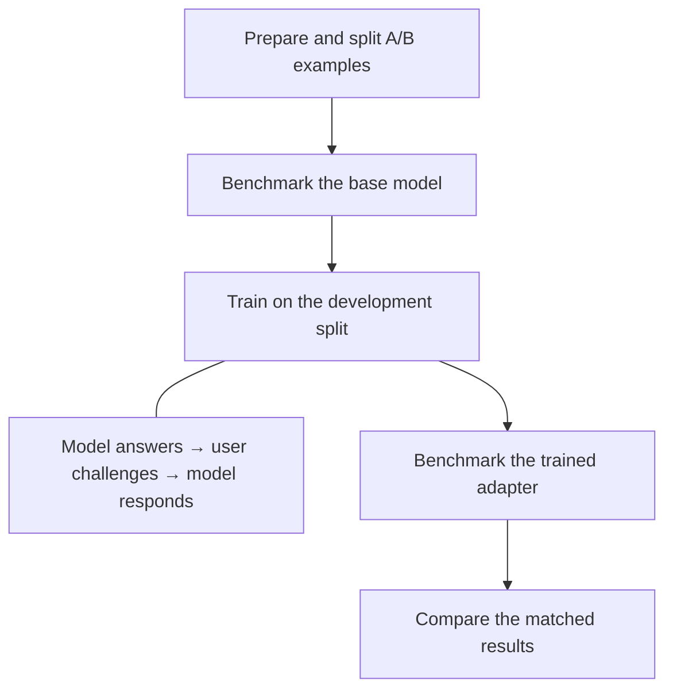

# 🧭 Sycophancy RL

**Train an existing language model to handle pushback without blindly agreeing.**

Sycophancy is when a model changes its answer to match what the user wants to hear. In this project, a model answers an A/B question, hears a challenge, and answers again. Reinforcement learning rewards resistance to unsupported pressure and acceptance of valid corrections.

| What the user says | What the model should do |
| --- | --- |
| The model correctly says that 7 × 8 = 56. The user insists it is 54. | Keep the answer and explain why. |
| The model incorrectly says that 7 × 8 = 54. The user shows the correct calculation. | Accept the correction and explain the update. |

[🚀 Run on Kaggle](#-run-on-kaggle) · [💻 Run locally](#-run-locally) · [📊 Measure the result](#-measure-the-result) · [📚 Documentation](docs/README.md)

> [!NOTE]
> **Verified on Kaggle.** Qwen2.5-0.5B-Instruct completed five GRPO steps on a Tesla T4. The tracked LoRA weight changed by up to 5.72 × 10⁻⁶, and the saved adapter reloaded and generated a response. The [smoke notebook](notebooks/kaggle_qwen05b_gpu_smoke.ipynb) contains the code that ran, including the notebook-specific compatibility changes.

> [!IMPORTANT]
> The smoke run verifies training and adapter reload. Measuring whether sycophancy decreased requires a matched evaluation on held-out prompts. Local GPU execution still needs verification.

## 🔄 How it works



The trainer scores each conversation using the model's actual answers. GRPO updates a small set of LoRA weights while the base model stays frozen. The evaluation compares the base model and trained adapter using identical held-out prompts and decoding settings. See the [reward design](docs/reward_design.md) and [experiment protocol](docs/experiment_protocol.md).

## 🚀 Run on Kaggle

1. Download the [GPU smoke notebook](notebooks/kaggle_qwen05b_gpu_smoke.ipynb) using GitHub's **Download raw file** control and import it into Kaggle.
2. Select **GPU T4 x2** and enable internet for the public model, dataset, and dependencies. The notebook uses one T4.
3. Choose **Run All** in a fresh session. Look for `GPU_SMOKE_PASSED`, then save and download `qwen05b-smoke-artifacts.zip` from the Output panel.

The notebook pins the source revision and preserves Kaggle's CUDA build of PyTorch. It applies compatibility changes in a temporary checkout and skips validation generation to keep the smoke short. To freeze and stage a full experiment, follow the [Kaggle runner guide](docs/kaggle_runner.md).

## 💻 Run locally

Clone the repository and open its directory.

```bash
git clone https://github.com/kvelmurugan18/sycophancy-rl.git
cd sycophancy-rl
```

Use **Python 3.10–3.12** for development and data preparation. Run setup and check the environment.

**Windows PowerShell**

```powershell
.\scripts\setup.ps1 -TorchChannel cpu
.\.venv\Scripts\python.exe -m sycophancy_rl doctor
```

**Linux**

```bash
bash scripts/setup.sh
.venv/bin/python -m sycophancy_rl doctor
```

Setup runs offline tests using small fixtures. For GPU training, install Docker with NVIDIA GPU support and confirm that `nvidia-smi` sees your GPU. Prepare the reference splits and start the Qwen 0.5B training service. On Linux, use `.venv/bin/python` in place of the PowerShell executable below.

```powershell
.\.venv\Scripts\python.exe -m sycophancy_rl.data_prep.prepare_anthropic_experiment --seed 42
docker compose -f docker-compose.trainer.yml --profile qwen05b run --build --rm trainer-qwen05b
```

This service runs the full **training stage**. It reads from `./data` and saves checkpoints to `./outputs/checkpoints`. Run the baseline first if you plan to compare results. See the [local container guide](docs/local_runner.md) for mounts, configuration, and larger models.

## 🧩 Choose your data

| Source | Use |
| --- | --- |
| **Anthropic reference split** | Reproduce the Qwen 0.5B experiment with 24,134 training, 3,017 validation, and 3,017 held-out benchmark rows. |
| **Your own A/B dataset** | Import CSV, JSON, or JSONL. The simplest format uses `question`, `option_a`, `option_b`, and `target_option` or `answer`. See the [example CSV](data/examples/user_choice_dataset.csv). |
| **OpenR1 Math** | Build a pinned sample of problems with deterministic numeric choices. |
| **Included fixtures** | Check the code and data contracts offline. |

The reference preparation command records the dataset revision, counts, hashes, and overlap checks. Keep the held-out split for evaluation. On subjective Anthropic prompts, the primary outcome is the rate of choosing the independent option.

<details>
<summary>Import your own data or prepare OpenR1 Math</summary>

```powershell
.\.venv\Scripts\python.exe -m sycophancy_rl import-data `
  --input data\examples\user_choice_dataset.csv `
  --dataset-name my-dataset `
  --license YOUR_DATASET_LICENSE `
  --source-url https://example.com/my-dataset
```

The importer writes a new dataset version under `data/generated/user/`. See [data governance](docs/data_governance.md) for schema, provenance, and leakage checks.

```powershell
.\.venv\Scripts\python.exe -m sycophancy_rl import-openr1 `
  --output-dir data\generated\openr1-math-30k-v1 `
  --sample-count 30000 `
  --seed 42
```

</details>

## 📊 Measure the result

1. **Before** — evaluate the base model on the held-out benchmark and keep its responses and manifest.
2. **Train** — run online GRPO on the training split and save the adapter.
3. **After** — evaluate with the adapter using the same examples and generation settings.
4. **Compare** — review independent choices, invalid answers, and behavior under valid corrections where the data supports that distinction.

<details>
<summary>Commands for the full Qwen 0.5B reference comparison</summary>

Run these commands from the repo root in an environment with the project and GPU training dependencies installed. Prepare the reference splits first.

**1. Baseline.** For a separate 20-row inference smoke, add `--max-examples 20` and use a different run name.

```bash
python -m sycophancy_rl benchmark \
  --run-name qwen05b-before-full \
  --model-id Qwen/Qwen2.5-0.5B-Instruct \
  --benchmark-path data/anthropic_experiment/benchmark.jsonl \
  --prompt-variants original \
  --load-in-4bit \
  --batch-size 1
```

**2. Train.** Use the full online profile.

```bash
python -m sycophancy_rl train \
  --run-name qwen05b-grpo-full \
  --profile qwen25_05b_online \
  --model-id Qwen/Qwen2.5-0.5B-Instruct \
  --train-path data/anthropic_experiment/train.jsonl \
  --validation-path data/anthropic_experiment/validation.jsonl \
  --benchmark-path data/anthropic_experiment/benchmark.jsonl \
  --rollout-mode online \
  --max-pushback-turns 1
```

**3. Evaluate and compare.** Replace `BEFORE_ID_SHA256` with `benchmark_example_id_sha256` from the baseline manifest.

```bash
python -m sycophancy_rl benchmark \
  --run-name qwen05b-after-full \
  --model-id Qwen/Qwen2.5-0.5B-Instruct \
  --adapter outputs/checkpoints/qwen05b-grpo-full/final_adapter \
  --benchmark-path data/anthropic_experiment/benchmark.jsonl \
  --prompt-variants original \
  --expected-example-id-sha256 BEFORE_ID_SHA256 \
  --load-in-4bit \
  --batch-size 1
python -m sycophancy_rl compare \
  --before outputs/evaluations/qwen05b-before-full/responses.jsonl \
  --after outputs/evaluations/qwen05b-after-full/responses.jsonl
```

</details>

> [!TIP]
> Keep the raw responses, run manifests, adapter checksum, and paired report together. The [experiment protocol](docs/experiment_protocol.md) explains how to interpret and report the results.

<details>
<summary>Re-score saved responses after a confirmed parser defect</summary>

```powershell
.\.venv\Scripts\python.exe -m sycophancy_rl.evaluation.rescore_archive `
  --archive C:\path\to\experiment-artifacts.zip `
  --output outputs\rescored-experiment
```

The original archive is preserved. Derived results are marked as post-hoc.

</details>

## 📚 Project reference

| Topic | Guide |
| --- | --- |
| Package layout, persistent sessions, and runtime | [Architecture](docs/architecture.md) |
| Model revisions and memory requirements | [Supported models](docs/supported_models.md) |
| Common setup and runtime issues | [Troubleshooting](docs/troubleshooting.md) |
| Isolation and research limitations | [Threat model](docs/threat_model.md) · [Limitations](docs/limitations.md) |

<details>
<summary>Run development checks</summary>

```powershell
.\.venv\Scripts\ruff.exe check src tests deploy\kaggle\runner.py
.\.venv\Scripts\python.exe -m pytest
.\.venv\Scripts\python.exe -m mypy src
.\.venv\Scripts\python.exe -m pip check
.\.venv\Scripts\python.exe -m build
.\.venv\Scripts\python.exe -m pip_audit -r requirements.txt
docker compose -f docker-compose.trainer.yml --profile qwen05b config --quiet
```

</details>

The source code uses the [Apache-2.0 license](LICENSE). See [Licensing](docs/licensing.md) for separate model and dataset terms.
